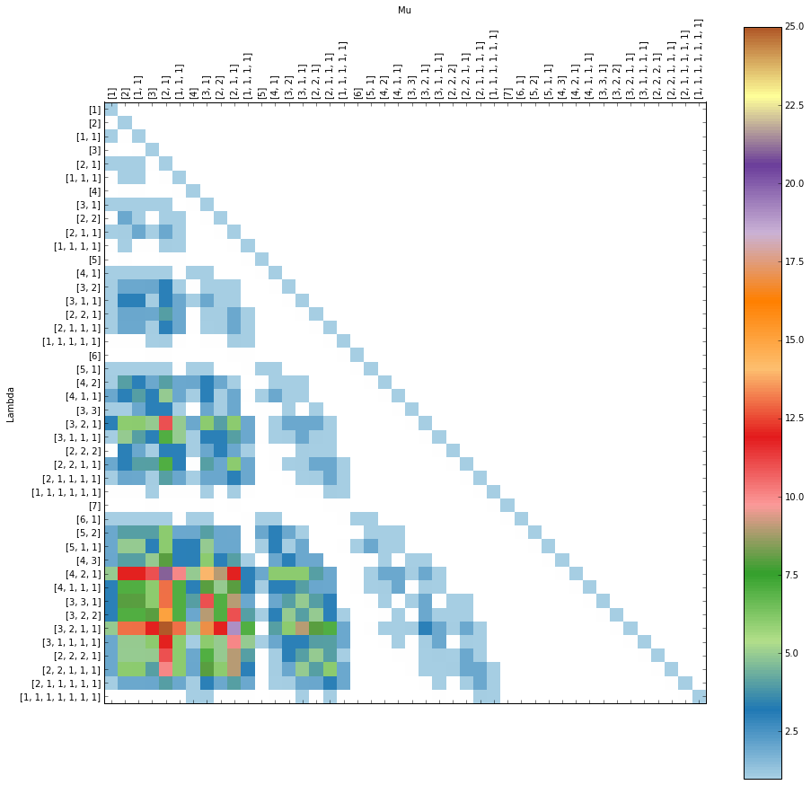
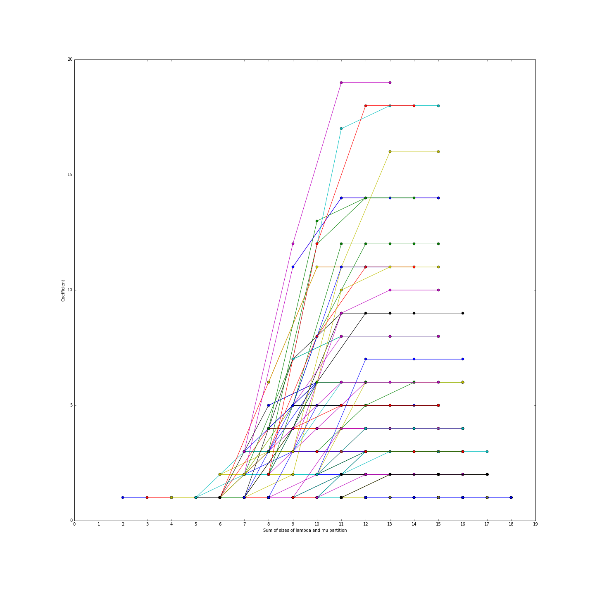

# Composition Factors

Computes the composition factors of the n-th tensor power of the free
associative algebra in terms of coefficients `cf[lambda_][mu]` indexing the
terms in the irreducible decomposition.

This repository provides:

- A fast algorithm computing the coefficients `cf[lambda_][mu]` for partitions `lambda_`, `mu`.
- A data-structure `Lie` capturing the representation theory of the free Lie algebra.
- Visualisations of the composition factors and certain stability phenomena.
- Sage-free total Whitney multiplicities from existing coefficients.
- Independent Sage calculations of ordinary and extended Whitney homology,
  optionally selected by block-size profile.

There is a [white paper](https://arxiv.org/abs/1711.04326) describing this algorithm on the arXiv.

**Historical data correction:** algorithm version 2 fixes duplicate decompositions
that first affect degree 12. The [checkpoint at `data/degree14`](data/degree14/README.md)
now contains the corrected replacement. Its predecessor had 350 overcounted
coefficients in seven degree-12 columns and remains only in Git/LFS history.
Historical timing and baseline-agreement measurements below do not establish
mathematical correctness.

## Installation

This is **SageMath code**, not a standalone NumPy program. It uses Sage's
partitions, symmetric functions, exact rational arithmetic, and Littlewood-
Richardson coefficients. Run it with Sage's Python, not an unrelated system
Python interpreter.

With [Miniforge](https://github.com/conda-forge/miniforge) installed:

```sh
conda env create -f environment.yml
conda activate composition-factors
sage --version
python -c 'from composition_factors import CompositionFactors; print(CompositionFactors(6).coeff([4, 2], [1, 1, 1]))'
```

The final command prints `2`. The environment pins SageMath 10.9 and Python
3.12; run these commands from the repository root with the environment
activated. SageMath 10.9's Conda entry point does not accept the older
`sage -python` option; use the environment's `python` directly.

For the exact Linux x86_64 package set used for the CPU computations below,
replace the environment creation command with:

```sh
conda create -n composition-factors --file conda-linux-64.lock
```

For an interactive session, start `sage` and import the classes explicitly:

```python
from composition_factors import CompositionFactors, Lie, Visualisations
```

To make the library and `composition-factors` command available outside the
repository directory, install into the activated Sage environment:

```sh
python -m pip install --no-deps --no-build-isolation -e .
composition-factors --help
```

SageMath must still be installed separately for computations and plots. Help,
checkpoint inspection, exact queries, checkpoint CSV export, and the derived
Whitney views use only Python's standard library and can also run directly as
`python compute.py ...` without Sage.

## Examples

Compute all coefficients for partitions of size up `n` with `cf = CompositionFactors(n)`.  

Given two partitions `lambda_` and `mu`, get at the coefficient `cf[lambda_][mu]` as follows.

~~~~
sage: cf = CompositionFactors(6) # computes all coefficients of degree <= 6
sage: lambda_ = Partition([4,2])
sage: mu = Partition([1,1,1])
sage: cf[lambda_][mu]
2
~~~~

You can see the all coefficients up a chosen degree in with the `display` method.

~~~~
sage: cf = CompositionFactors(7)
sage: cf.display()
~~~~



We also provide a `Visualisations` class to investigate new stability phenomena. Here we investigate PD-module stability among the coefficients. Concretely, this is the stability that occurs when you add one box to the first row in each partition `lambda_` and `mu`. The method `PD_stability` plots how the coefficients evolve under this stability.

~~~~
sage: cf = CompositionFactors(10)
sage: vis = Visualisations(cf)
sage: vis.PD_stability()
~~~~



## Headless computations and saved results

On a CPU server without a display, select Matplotlib's noninteractive backend:

```sh
MPLBACKEND=Agg python - <<'PY'
from composition_factors import CompositionFactors, Visualisations

cf = CompositionFactors(6)
print(cf.coeff([4, 2], [1, 1, 1]))
cf.save("composition_factors_6")
cf.display(width=10).savefig("composition_factors_6.png", dpi=150)
Visualisations(cf).PD_stability(width=10).savefig("pd_stability_6.png", dpi=150)
PY
```

Reload with `CompositionFactors.load("composition_factors_6")`. Sage's `.sobj`
files use pickle: only load files from a trusted source. The nested `coeffs`
dictionary contains exact coefficients; the NumPy `matrix` is a floating-point
view intended for visualisation, not exact large-integer arithmetic. The matrix
is constructed only when accessed or plotted; saving a result does not force
its construction.

This low-level pickle loader does not validate checkpoint provenance or repair
historical coefficients. Use the checked JSON/checkpoint commands below for
archived results, and replace pre-correction data reaching degree 12 rather than
reloading it unchanged.

`coeff(lambda_, mu)` accepts nonempty, weakly decreasing partitions of positive
integers within the computed range. It returns zero when the mu degree exceeds
the lambda degree, and raises `ValueError` for uncomputed or malformed queries.
Computation degrees must be positive integers. Degree zero and the empty
partition are outside this API's domain. Direct nested-dictionary access
remains available, including its existing triangular storage convention.

Stability plots include the highest computed degree. `seq_length` is an
inclusive minimum; FI plots use the size of the lambda-partition, and PD plots
use the sum of the two partition sizes.

Start with degree 6 before attempting larger computations: the number of
partitions, decompositions, and assembly instructions grows rapidly. No GPU is
required. Repeated Schur plethysms are cached within each degree's Lie instance;
complete assemblies are also cached for the duration of one degree. The
computation and instruction lookup share Lie data. Decompositions are generated
only for requested shapes, with canonical ordering that removes duplicate
permutations while preserving multiplicities.
For controlled comparisons or a lower-memory run, the library accepts
`CompositionFactors(n, cache_assemblies=False)` to disable complete-assembly
caching while retaining the plethysm cache.

### Plot controls and exact trajectories

```python
cf.display(ticks=False)  # genuinely suppress both axes' ticks
cf.display(ticks="degree", cmap="historical", normalization="log")
vis = Visualisations(cf)
sequences = vis.stability_sequences("PD", seq_length=3, unique=True)
figure = vis.PD_stability(seq_length=3, unique=True)
```

`ticks="degree"` labels degree blocks instead of every partition. The
`historical` palette reconstructs the continuous 256-color Paired palette used
in the original figures; the default remains modern Matplotlib's `Paired`.
Any Matplotlib palette name is accepted. Normalization is `linear` by default,
or `log` for positive coefficients; zeros remain white. These are display
choices and never modify exact values.

`stability_sequences("PD" or "FI", ...)` returns starting `lambda`/`mu` tuples,
`sizes`, and integer `coefficients` without importing Matplotlib. By default,
all positive starting coefficients are considered, preserving the previous
plots. `unique=True` retains only the earliest start in each chain satisfying
the length and resolution filters, instead of redrawing its suffixes.

### Verified CPU example

With SageMath 10.9 and Python 3.12.16, computation through degree 10 gives
138 partitions and 11,313 stored coefficients, of which 4,668 are nonzero.
All 19,044 pairs in the full matrix agree with a separate truncated power-sum
plethysm calculation. The documented coefficients `2` and `84` are reproduced,
and saving, reloading, and all three headless plots work.

Before the follow-up optimizations, on the same two-CPU Linux devbox, a
fresh-process `CompositionFactors(10)`
computation took 36.2 seconds with compatibility repairs alone and 6.1 seconds
with plethysm caching. These are single-run timings excluding imports, plots,
and the independent comparison, not a general performance guarantee. Checks
through degree 10 do not establish correctness in arbitrary degree.

### Follow-up optimization benchmarks

After adding complete-assembly caching, per-shape decomposition generation,
and shared Lie setup, matching fresh-process measurements on the same CPU host
and pinned environment gave:

| Computation through degree | Modernization baseline | Follow-up implementation | Speedup |
| --- | ---: | ---: | ---: |
| 10 | 6.14 s | 3.27 s | 1.87x |
| 12 | 58.77 s | 29.08 s | 2.02x |

Degree 10 uses the median of three interleaved runs per implementation;
degree 12 uses one run each. Timings include all positive degrees through the
target **and construction of the dense matrix**, excluding imports,
serialization, plots, and independent comparisons. This accounts for the new
implementation's lazy matrix rather than comparing different amounts of work.
All 11,313 stored coefficients through degree 10 and all 43,044 through degree
12 retain their exact baseline hashes. These measurements do not imply the
same speedup at every degree.

## Larger CPU runs

Run larger computations without plotting first, and save the exact coefficients
before doing additional analysis. In the activated environment on Linux, this
example limits the whole command to ten minutes, the Python process's virtual
address space to 12 GiB, and BLAS/OpenMP to one thread:

```sh
timeout --signal=TERM --kill-after=20s 600 \
  env MPLBACKEND=Agg OPENBLAS_NUM_THREADS=1 OMP_NUM_THREADS=1 python -u - <<'PY'
import resource
from time import perf_counter

resource.setrlimit(resource.RLIMIT_AS, (12 * 1024**3, 12 * 1024**3))

from composition_factors import CompositionFactors

degree = 12
print(f"Computing through degree {degree}...", flush=True)
start = perf_counter()
cf = CompositionFactors(degree)
seconds = perf_counter() - start
cf.save(f"composition_factors_{degree}")
print(f"Computed in {seconds:.1f} seconds; matrix shape: {cf.matrix.shape}")
print(f"Peak RSS: {resource.getrusage(resource.RUSAGE_SELF).ru_maxrss / 1024:.1f} MiB")
PY
```

The `resource` limit is an address-space ceiling, not a reservation of RAM.
Each invocation of this example computes all degrees up to the requested degree
from scratch.
If the timeout interrupts computation before `save`, no result for that run
is saved; previously saved files remain available. Reload a completed result
to plot it without repeating the computation.

On the same two-CPU devbox and pinned environment, degree 12 completed in
60.6 seconds: 271 partitions, 43,044 stored coefficients, and 17,016 nonzero
coefficients. Peak process RSS, including save/load and comparisons, was
413 MiB. All 11,313 stored coefficients through degree 10 were unchanged.
A separate direct-plethysm comparison matched 2,981 pairs: every lambda row
against the 11 mu-partitions of sizes 1 through 4. This is a partial independent
check of degree 12, unlike the complete matrix comparison through degree 10.

A degree-14 attempt reached the ten-minute wall-time limit without a completed
result. It was stopped by the configured timeout, with no reported out-of-memory
event. This does not establish that degree 14 cannot finish with more time.

### Checkpointed computations

`compute.py` saves each completed degree before moving on. It uses the same
per-degree algorithm as `CompositionFactors`, without generating plots:

```sh
python -u compute.py --degree 12 --output results/first-run
python -u compute.py --degree 14 --resume results/first-run/degree12 \
  --output results/resumed-run
```

The resumed run computes only degrees 13 and 14, saving them under
`results/resumed-run/degree13` and `results/resumed-run/degree14`. Each checkpoint
contains exact `coefficients.json`, a reloadable `composition_factors.sobj`, and
`report.json` with counts, source/coefficient hashes, incremental timing, and
peak process RSS. **Each timing measures the new degree only**, not a fresh
computation through that degree. RSS is the peak of the current process.
The CLI reports setup stages and counts of completed mu partitions within each
degree. Use `--progress-interval SECONDS` to adjust the default 30-second
reporting interval; counts measure completed inputs, not estimated elapsed-time
percentages. A single expensive input can still take longer than the interval.

Use a **new output directory for each invocation**; existing directories are
never overwritten. After an interruption, resume from the highest degree whose
`report.json` was saved, using another output directory. Work within an
unfinished degree is not resumed. Earlier checkpoints remain available even if
a later computation or optional comparison fails.

Only resume trusted checkpoints: `.sobj` uses pickle, and the hashes are
integrity checks, not a security boundary. Resumption requires the same
`composition_factors.py` source hash, matching coefficient data, and a
successful save/load record. A checkpoint with a failed independent comparison
is rejected. A pending comparison is reported as unfinished, not passed.
Use the explicit migration command below after a compatible source update.
Ordinary resumption never silently ignores a source mismatch.

For a bounded Linux run in the activated environment:

```bash
set -o pipefail
mkdir -p results
timeout --signal=TERM --kill-after=20s 7200 \
  env MPLBACKEND=Agg OPENBLAS_NUM_THREADS=1 OMP_NUM_THREADS=1 \
  bash -ec 'ulimit -v 12582912; exec python -u compute.py \
    --degree 14 --resume results/first-run/degree12 \
    --output results/bounded-run' 2>&1 | tee results/bounded-run.log
```

This uses a two-hour total budget, a 20-second kill grace, and a 12 GiB
virtual-address-space limit. The command runs in the foreground; use your
scheduler or terminal multiplexer for an unattended job. Checkpoints and logs
are ordinary local files, with no dependency on a particular cluster, account,
or home directory.

For an optional independent comparison, add `--reference`. This checks the full
matrix at every newly computed degree and can be expensive. To compare only
mu-partitions of sizes at most 4, add both `--reference` and
`--reference-max-mu-size 4`; intermediate degrees use the smaller applicable
bound. Reports record the actual number of pairs compared. A checkpoint is
saved before this comparison, and a mismatch produces a nonzero exit.

### Inspect, query, export, compare, and migrate

All commands also work as `python compute.py COMMAND ...`. Existing invocations
such as `python compute.py --degree 6 --output results/run` remain supported.

```sh
composition-factors inspect results/first-run/degree12
composition-factors query results/first-run/degree12 --lambda 4,3,3 --mu 3,2
composition-factors export results/first-run/degree12 --output coefficients.csv --nonzero
composition-factors compare results/first-run/degree12 --reference-max-mu-size 4
composition-factors plot results/first-run/degree12 --output matrix.png \
  --ticks degree --palette historical --normalization log
composition-factors plot results/first-run/degree12 --kind pd --unique \
  --seq-length 3 --output pd.png
composition-factors migrate results/first-run/degree12 --output results/migrated12
composition-factors compute --degree 14 --resume results/migrated12 \
  --output results/continued
```

Inspection, queries, and export read exact JSON, not pickle, and need no Sage.
CSV columns are `lambda`, `mu`, and `multiplicity`; partitions use comma-separated
parts and are CSV-quoted where necessary. `--nonzero` omits zero records.
All output files/directories must be new. Plotting and comparison load existing
exact data without recomputing its coefficients or modifying the checkpoint.
Comparison checks all columns unless a bound is supplied.
The independent power-sum calculation caches each substituted power-sum
product across mu partitions, without using the optimized assembly algorithm.

Migration supports the current algorithm version. Algorithm-version-1 checkpoints
and the recognized pre-versioning modernization source
`3f6234d0539e7bca6fa4548416c6b728bb2807666b27c1b1d924e8ec8dc8241b`
are accepted only through degree 11, before the first possible overcount.
Migration does not repair coefficients: historical checkpoints reaching degree
12 must be replaced with corrected data or recomputed from an earlier checkpoint.
It verifies the complete stored shape, exact hash, nonnegative integer values,
same-degree identity entries, and all column dimensions; compares mu sizes up to 4 by
default; and writes a new checkpoint with the current source hash and original
provenance. Use `--reference-max-mu-size N` to change that comparison scope.
The partial comparison is not a proof of all coefficients. Unknown legacy
sources or algorithm versions are rejected rather than overridden. Original
files are untouched, and migration reads no pickle.

### Whitney homology from existing coefficients

The `whitney` commands provide **total ordinary and extended Whitney
multiplicities**, derived from the validated composition-factor checkpoint.
They do not run Sage, load pickle, modify the checkpoint, or create a second
canonical dataset. The supplied checkpoint supports these queries through
degree 14.

Work in characteristic zero. Here `degree` is the underlying set size `n`,
`blocks` is the number of blocks `i`, and the lattice rank is `n - i`.
The interface supports only **positive rank**, `1 <= i < n`. Rank zero
(`i = n`), empty partitions, zero blocks, and degrees outside the checkpoint
raise errors rather than silently selecting a bottom convention or returning
zero. A zero multiplicity within the supported domain remains an exact zero.

For partitions $\lambda\vdash n$ and $\mu\vdash i$, the extended multiplicity of
$P_\mu\otimes P_\lambda$ is

$$
d_{\lambda,\mu}=c_{\lambda',\mu'}.
$$

Both labels are conjugated; the matrix axes are not transposed. This is the
total-character consequence of the sign twists in
[the thesis](https://hdl.handle.net/1813/64873), Definition 6.2.16 and
Theorem 6.2.19. Taking the trivial block-action component, $\mu=(i)$, gives
ordinary Whitney homology (Lemma 6.2.15):

$$
[P_\lambda:WH_{i,n}]=d_{\lambda,(i)}=c_{\lambda',(1^i)}.
$$

```sh
# Ordinary multiplicity: prints 2.
python compute.py whitney query data/degree14 --lambda 3,1 --blocks 2
# Extended multiplicity: prints 1 for the sign representation of the block action.
python compute.py whitney query data/degree14 --lambda 3,1 --mu 1,1
# Ordinary decomposition with zero terms omitted.
python compute.py whitney decompose data/degree14 --degree 4 --blocks 2 --nonzero
# Derived JSON and CSV files; each output path must be new.
python compute.py whitney export data/degree14 --degree 4 --blocks 2 \
  --format json --output whitney-4-2.json --nonzero
python compute.py whitney export data/degree14 --degree 4 --blocks 2 --extended \
  --format csv --output extended-whitney-4-2.csv
```

`query` requires exactly one of `--blocks` (ordinary) and `--mu` (extended).
`decompose` and `export` default to ordinary; `--extended` includes both
partition labels. All multiplicities, including zeros, are returned by default;
`--nonzero` omits zeros. For example, the ordinary decomposition above is
$2P_{(3,1)}\oplus P_{(2,2)}\oplus P_{(2,1,1)}$, of dimension 11.

The standard-library API is:

```python
from pathlib import Path
from coefficient_data import read_checkpoint
from whitney_data import WhitneyData

whitney = WhitneyData(read_checkpoint(Path("data/degree14")))
whitney.ordinary_coeff([3, 1], blocks=2)  # 2
whitney.extended_coeff([3, 1], [1, 1])  # 1
result = whitney.decomposition(4, 2, extended=True, nonzero=True)
```

JSON output includes `kind`, `degree`, `blocks`, `rank`, characteristic-zero and
positive-rank conventions, the source checkpoint's degree/algorithm/hash, and
exact integer `coefficients`. Ordinary records have `lambda` and `multiplicity`;
extended records additionally have `mu`. This version-1 **derived-output**
schema is not a composition-factor checkpoint and cannot be resumed or migrated.
CSV columns are `kind`, `degree`, `blocks`, `rank`, `lambda`, `mu`,
`multiplicity`, and `source_coefficient_sha256`. Partitions are comma-separated
and CSV-quoted; `mu` is empty for ordinary coefficients.

This lookup layer implements the relabeling formula, not a chain complex or
Lean proof. Contributions from individual block-size profiles cannot be
recovered from the aggregate table. Use the independent calculation below
when those contributions, or a calculation without a checkpoint, are needed.

### Computing Whitney homology directly

`whitney compute` uses **SageMath**, but needs **no checkpoint**. It calculates
ordinary or extended Whitney multiplicities from the signed-plethysm formulas
in the thesis, Theorem 6.2.19 and Remark 6.2.21. It does not import the
composition-factor engine or reuse its decomposition/assembly algorithm.

Run these commands with the activated Sage environment's `python`:

```sh
# Ordinary contribution from set partitions having two blocks of size two.
python compute.py whitney compute --degree 4 --blocks 2 --type 2,2 --nonzero
# Extended contribution from block sizes three, two, and one.
python compute.py whitney compute --degree 6 --blocks 3 --type 3,2,1 \
  --extended --nonzero
# Total extended homology: sum all block-size profiles with four blocks.
python compute.py whitney compute --degree 8 --blocks 4 --extended
# Save an exact type-selected result; both flags are required for file output.
python compute.py whitney compute --degree 6 --blocks 3 --type 3,2,1 \
  --extended --format json --output whitney-6-type-321.json
python compute.py whitney compute --degree 6 --blocks 3 --type 3,2,1 \
  --extended --format csv --output whitney-6-type-321.csv
```

`--type` is a weakly decreasing list of block sizes, **not** an irreducible
representation label. Its parts must sum to `--degree`, and its length must
equal `--blocks`. Omitting it sums all such profiles. Ordinary is the default;
`--extended` includes both `lambda` (the underlying-set action) and `mu` (the
block action). Zeros are included unless `--nonzero` is specified. Without
`--output` and `--format`, the result is printed as JSON. Existing files are
never overwritten.

For example, the ordinary contributions at degree four and two blocks are

$$
WH_{(3,1)} = P_{(3,1)} \oplus P_{(2,2)} \oplus P_{(2,1,1)},\qquad
WH_{(2,2)} = P_{(3,1)}.
$$

Their sum is the total decomposition above. For the extended contribution
of type $(2,2)$, the trivial block representation pairs with $P_{(3,1)}$,
whereas the sign block representation pairs with $P_{(4)}\oplus P_{(2,2)}$.
This distinction checks the sign associated with exchanging equal even-sized
blocks; a dimension check alone cannot detect the wrong sign.

The calculation first builds $\widehat{\mathrm{Lie}}_j=\omega(\mathrm{Lie}_j)$
from the exact power-sum Mobius formula. For a profile
$\rho=1^{m_1}2^{m_2}\cdots$, ordinary homology has character

$$
\operatorname{ch}(WH_\rho)
=\prod_{j\ \mathrm{odd}} h_{m_j}[\widehat{\mathrm{Lie}}_j]\,
 \prod_{j\ \mathrm{even}} e_{m_j}[\widehat{\mathrm{Lie}}_j].
$$

For extended homology, enumerate $\nu_j\vdash m_j$. The coefficient of $s_\mu$
in $\prod_j s_{\nu_j}$ gives the block-restriction multiplicity. Multiply the
ambient factors $s_{\nu_j}[\widehat{\mathrm{Lie}}_j]$, conjugating $\nu_j$ only
when $j$ is even, and accumulate with that multiplicity. The block-action
factor uses the original $\nu_j$, not its even-index conjugate.

The Sage API is:

```python
from pathlib import Path
from whitney_calculation import WhitneyCalculator

calculator = WhitneyCalculator()
result = calculator.decomposition(6, 3, block_type=[3, 2, 1], extended=True)
calculator.export_json(Path("whitney-6-type-321.json"), 6, 3, block_type=[3, 2, 1], extended=True)
```

The calculator also accepts Sage integers and a Sage `Partition` as the
block-size profile. Returned labels and multiplicities are ordinary Python
integers; floats and booleans are rejected rather than coerced.

Twisted Lie characters and individual plethysms are cached for each calculator
instance's lifetime. This is a small-degree reference implementation, not an
optimized replacement for large composition-factor runs. There is no
checkpoint-degree limit, but higher-degree runtime has not been established.
The characteristic-zero and positive-rank restrictions remain unchanged;
rank-zero conventions, chain-level representatives, and Lean proofs are
outside this interface.

Calculated JSON retains the version-1 derived-output envelope and record
conventions, with `calculation: "signed_plethysm"` and a `block_type` list
(`null` for totals). Its `source` contains the **Whitney** `algorithm_version`
(currently 1), calculator `source_sha256`, and `sage` version, not a checkpoint
hash or the composition-factor algorithm version. Calculated CSV starts with
`kind,degree,blocks,rank,lambda,mu,multiplicity`, followed by
`block_type,characteristic,convention,calculation,calculation_version,source_sha256,sage`.
An empty CSV `block_type` means total; an empty `mu` means ordinary.
The existing lookup CSV columns are unchanged. Neither kind of derived output
is a resumable composition-factor checkpoint, and no second canonical dataset
is maintained.

The reference calculation has been checked against the corrected checkpoint
for all 28 positive-rank bidegrees through degree 8: 350 ordinary and 1,719
extended total multiplicities, including zeros. All 58 block-size profiles
in that range were checked for type sums, ordinary invariants, and dimensions
$n!/\prod_j(j^{m_j}m_j!)$ (ordinary) and $i!$ times that value (extended).
The two block types at degree four and two blocks were also checked against
actual interval homology on all 48 elements of $S_2\times S_4$, separately
for each type. These are numerical character checks, not formal Lean proofs.

### Exact JSON format

New reports declare `format_version: 1` and `algorithm_version: 2`. The former
versions the file contract; the latter identifies the mathematical algorithm's
compatibility contract, independently of formatting and plotting changes.
The source and runner hashes still record the actual implementation bytes.

`coefficients.json` remains a list of records:

```json
{"lambda": [2, 1], "mu": [1], "multiplicity": 1}
```

Each pair appears exactly once for every positive lambda degree up to the
reported degree and every positive mu degree at most that lambda degree,
including zeros. Parts must be positive integers in weakly decreasing order,
and multiplicities must be nonnegative integers. Same-degree entries form an
identity matrix. The SHA-256 hashes the list sorted lexicographically by
`(lambda, mu)`, serialized with record fields in the order above and compact
JSON separators, without the final newline.

`coefficient_data.read_checkpoint(path)` validates this contract, reported
counts, the coefficient hash, and representation dimensions, and returns exact
Python integers. Historical unversioned reports using the same record layout
are readable as format 0 if they satisfy these checks.
Unknown formats, duplicate/missing entries, malformed values, inconsistent
counts, hash mismatches, and recorded failed comparisons are rejected. A
reported successful comparison must include its exact pair count and mu-size
bound, and these must agree with the validated partition domain. Resumption
also rejects an incompatible algorithm version even if the source hash matches. Hashes
detect inconsistency, not maliciously rewritten data or mathematical errors.

For each target degree and mu partition, the reader and checkpoint writer require

$$
\sum_{\lambda\vdash n} f^\lambda c_{\lambda\mu}
  = f^\mu \left[{n\atop |\mu|}\right],
$$

where `f` is the Specht dimension from the hook-length formula and the bracket
is an unsigned Stirling number of the first kind. Reports record the number of
degree/column identities in `dimension_columns_checked`. This inexpensive
necessary condition detects the historical overcount even when hashes agree;
it is not a substitute for independent coefficient-by-coefficient comparison.

The cause was an incomplete ordering key for decomposition parts. Distinct
partitions such as `(3,1)` and `(2,2)` tie in both size and length, so both
orders survived deduplication while assembly already enumerated both assignments.
The key now also includes the full partition. Repeated identical parts still
retain their factorial correction, and repeated Lie summands keep their
multiplicities.

### Historical degree-14 runs (algorithm version 1)

These runs retained the degree-12 overcount. Their timings and exact agreement
with each other remain historical measurements, not a correctness certificate.

A subsequent two-hour-budget run successfully extended the saved degree-12
result through degrees 13 and 14 on the same CPU host and environment. The new
degree-13 computation took 202.5 seconds; degree 14 took 1,607.8 seconds
(26.8 minutes). The whole resumed job, including imports, serialization, and
comparisons, took 30 minutes 39 seconds. These are incremental timings, not
fresh-process computations of all degrees through 13 or 14.

The degree-14 result contains 507 partitions, **149,061 stored coefficients**
and **56,557 nonzero coefficients**. Its full visualization matrix has
**257,049 entries**, matching the thesis's reported degree-14 matrix size.
Matching that size alone is not a comparison against the original dataset.
Peak process RSS was 826 MiB. All 80,616 stored coefficients through degree 13
were preserved. The independent comparison matched 5,577 pairs: all 507 lambda
rows against the 11 mu-partitions of sizes 1 through 4, not the whole matrix.
The run used the pre-versioning modernization source hash documented above and
a precursor of the portable checkpoint runner. Its saved exact coefficients
serve as a baseline for subsequent optimization work.

After the follow-up optimizations, another checkpointed run from degree 12
reproduced all **80,616 stored coefficients through degree 13** and all
**149,061 through degree 14** exactly, including zeros. The new incremental
timings were 126.0 seconds for degree 13 and 1,519.2 seconds (25.3 minutes) for
degree 14. These are single checkpoint-run observations, not the repeated
fresh-process benchmarks above. The improvement at degree 14 is modest
compared with its earlier 26.8 minutes; the roughly twofold speedup at lower
degrees does not persist here.

The degree-14 run spent about 23.5 minutes before reporting its first completed
mu partition. This identifies where further profiling is needed, rather than
establishing a detailed cost breakdown. Peak process RSS was 681 MiB, including
serialization and comparisons. Independent comparisons again passed for
4,092 pairs at degree 13 and 5,577 at degree 14, using mu sizes at most 4.
Those partial independent comparisons are distinct from the complete exact
agreement with the saved baseline.

### Fresh corrected degree-14 run (algorithm version 2)

A new run computed every degree from 1 through 14 from scratch, without
resuming historical data. Coefficient computation took **29 minutes 57 seconds**
in total; degree 14 alone took **27 minutes 12 seconds**. The computation loop,
including full independent comparisons at every checkpoint and checkpoint I/O,
took **33 minutes 44 seconds**.

The final independent comparison covered all **257,049 full-matrix entries**,
not just small mu columns. All **149,061 stored coefficients** matched the
earlier corrected reconstruction: the differences from the original remain
exactly **350 coefficients in seven degree-12 columns**.
The corrected snapshot includes its fresh-run report, all fourteen per-degree
reports in `run.json`, and the exact old/new correction list.

### Download the degree-14 checkpoint

The [corrected checkpoint](data/degree14/README.md) contains exact coefficients
through degree 14 and the corresponding Sage checkpoint. Its two payload files
use Git LFS. Reports, checksums, the exact correction list, and provenance
documentation remain ordinary Git files. This is the single current dataset;
the incorrect predecessor is retained in Git/LFS history, not a second directory.

Install [Git LFS](https://git-lfs.com/) first, then run from a Git checkout:

```sh
git lfs install --local
git lfs pull --include="data/degree14/coefficients.json,data/degree14/composition_factors.sobj"
(cd data/degree14 && shasum -a 256 -c SHA256SUMS)
python compute.py inspect data/degree14
```

Inspection needs no Sage and does not load pickle. Without the LFS download,
the payload paths may contain small pointer files, not computation data.
See the dataset README for JSON-only access, provenance, and trusted-checkpoint
usage. Save local experiments to a separate output directory rather than
overwriting the checked-in snapshot.

CI checks pointer structure without downloading the payloads. LFS storage and
downloads count against the repository owner's allowance; each changed payload
is stored as a complete new version. See
[GitHub's LFS billing documentation](https://docs.github.com/en/billing/concepts/product-billing/git-lfs).

## Regression checks

The regression suite covers the documented coefficient, degree-three matrix
and direct plethysm, save/load, independent instruction copies, decomposition
iteration, headless stability plots, checkpoint resumption, integrity checks,
and failed independent comparisons:

```sh
MPLBACKEND=Agg python -m unittest discover -s tests
```

Additional coverage guards the degree-10 exact hash, cached/uncached assembly
equivalence, repeated Lie summands, canonical decomposition order (including
distinct partitions tied in size and length), dimension identities, lazy
matrices, public input boundaries, plot controls, unique trajectories,
Sage-free JSON/CLI operations, and explicit checkpoint migration. Whitney
coverage includes conjugation of both labels, ordinary/extended agreement,
small decompositions, positive-rank boundaries, exact JSON/CSV outputs, and
source preservation. The standard-library cases can run without Sage:

```sh
python -m unittest discover -s tests -p 'test_*data.py'
```

Sage-only Whitney cases cover type-selected examples, even-block sign twists,
total agreement and type dimensions through degree six, independent rank-two
interval characters, checkpoint-free CLI calculations, and exact exports.
These cases are included in the full suite, not the standard-library subset.

For local linting and formatting:

```sh
python -m pip install -e '.[dev]'
ruff check .
ruff format --check .
```

The legacy mathematical module is linted but excluded from whole-file
reformatting to keep mathematical changes reviewable. CI checks the standard-
library data tools separately and runs the full regression suite in the exact
Linux Sage environment from `conda-linux-64.lock`.
